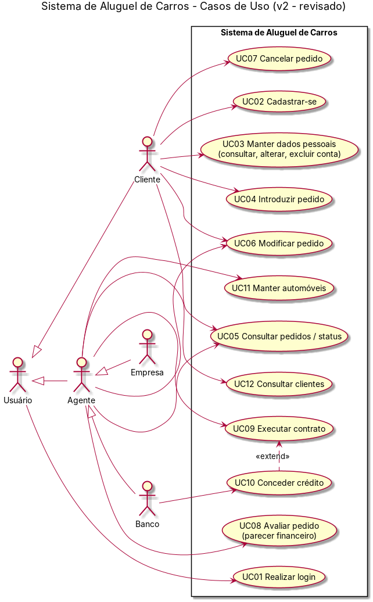
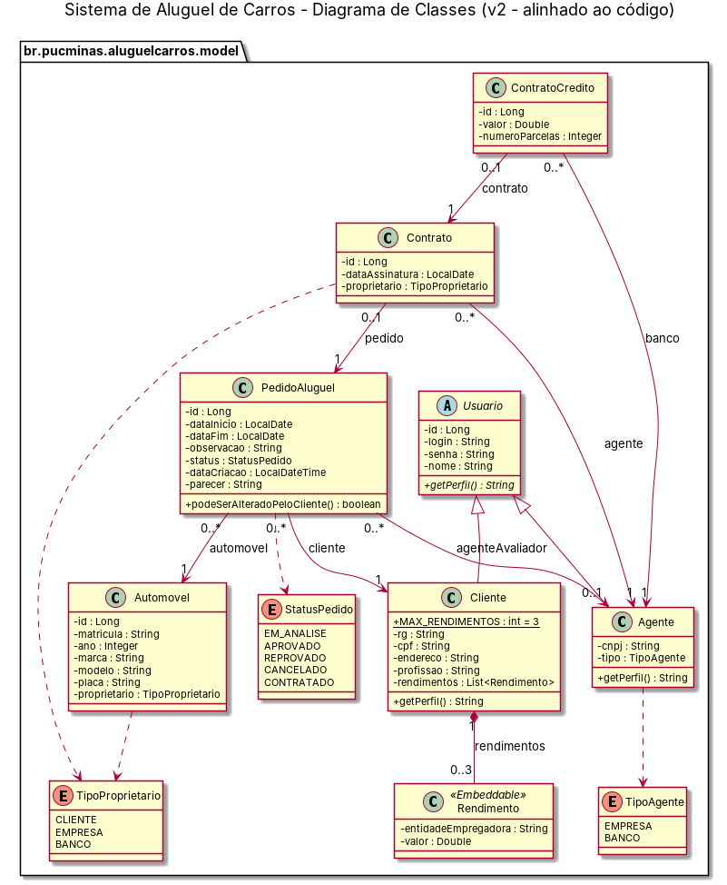
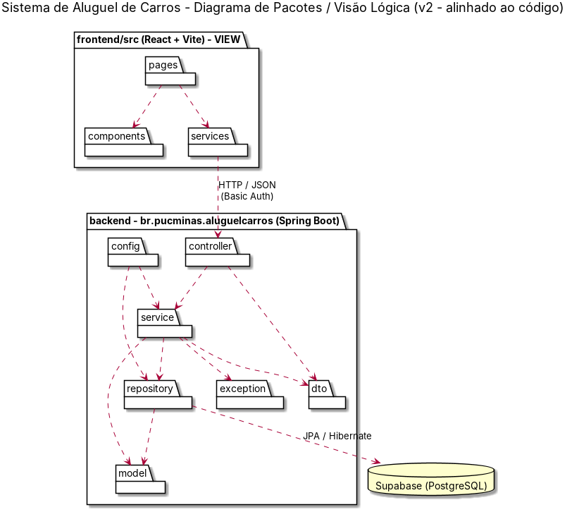
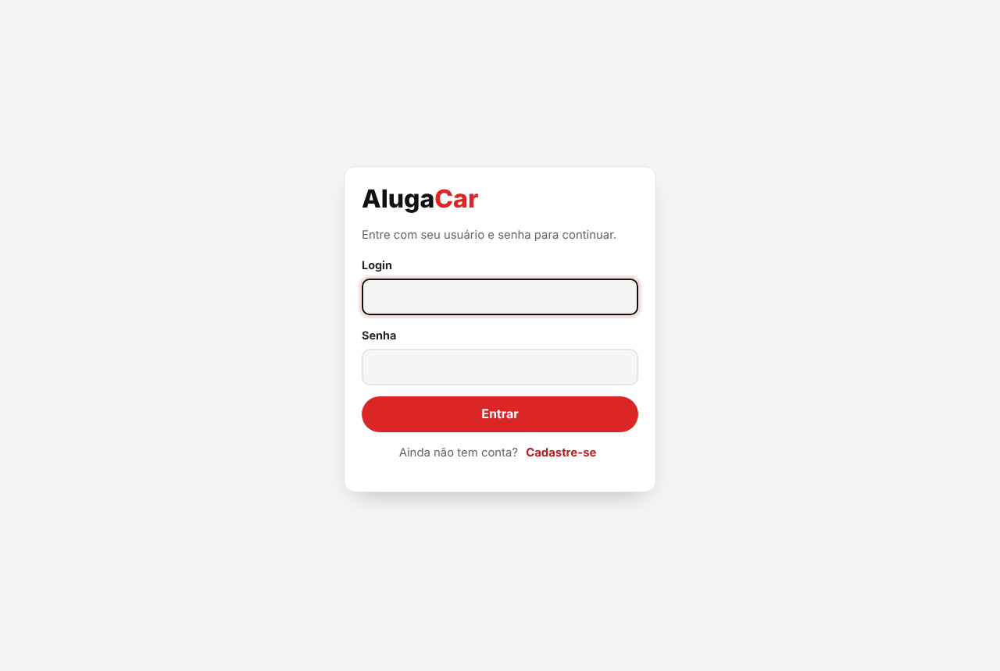
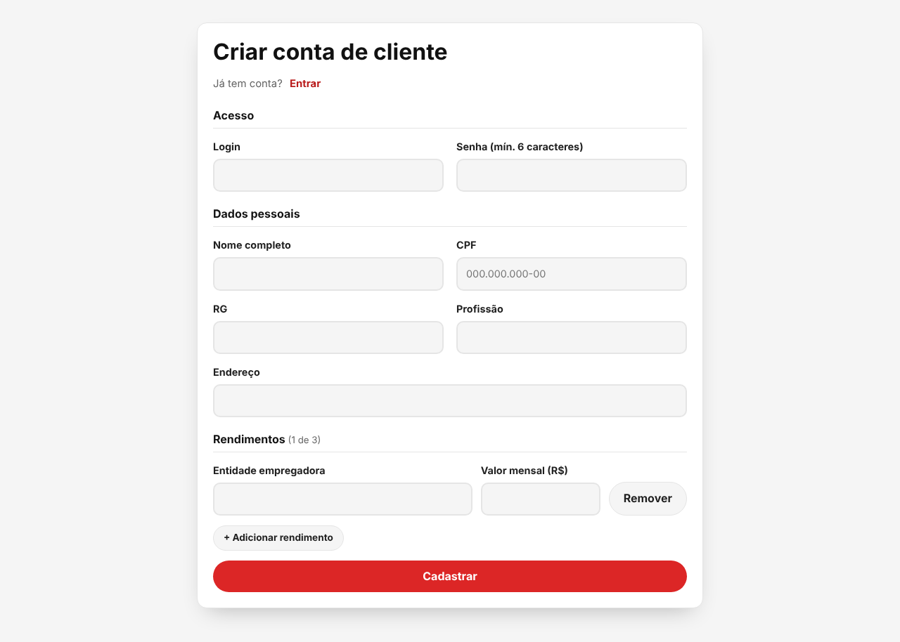
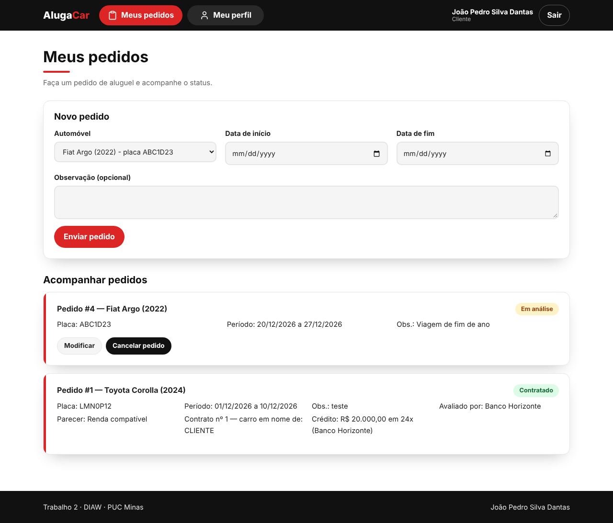
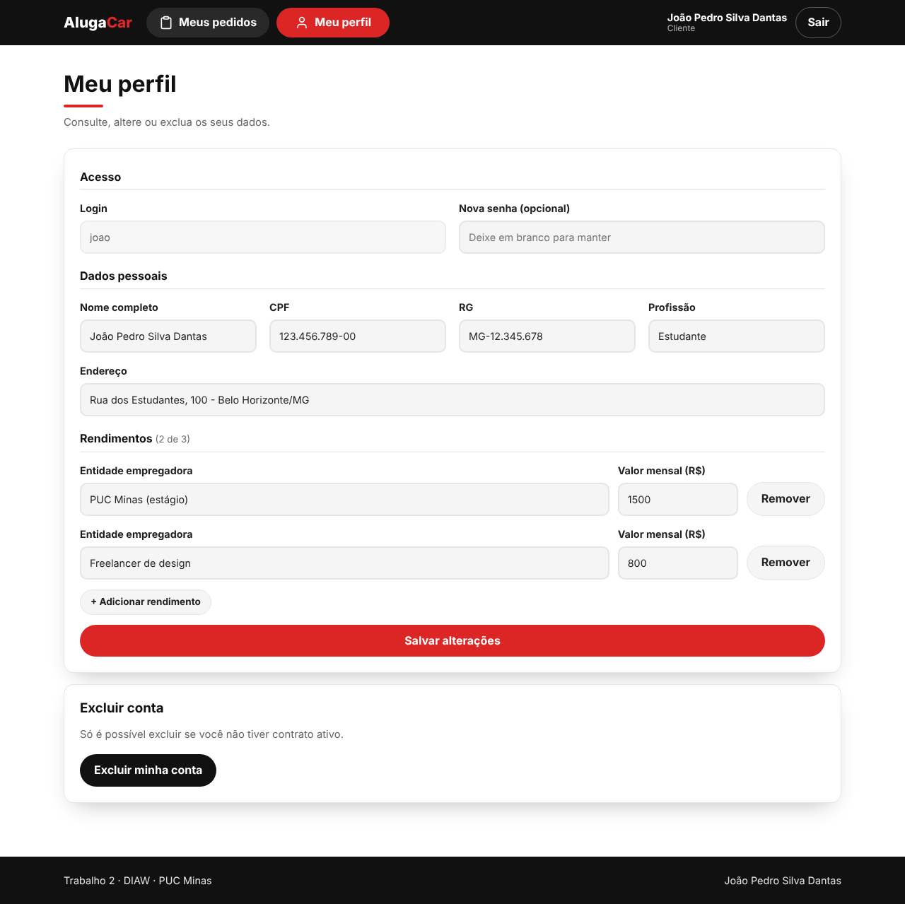
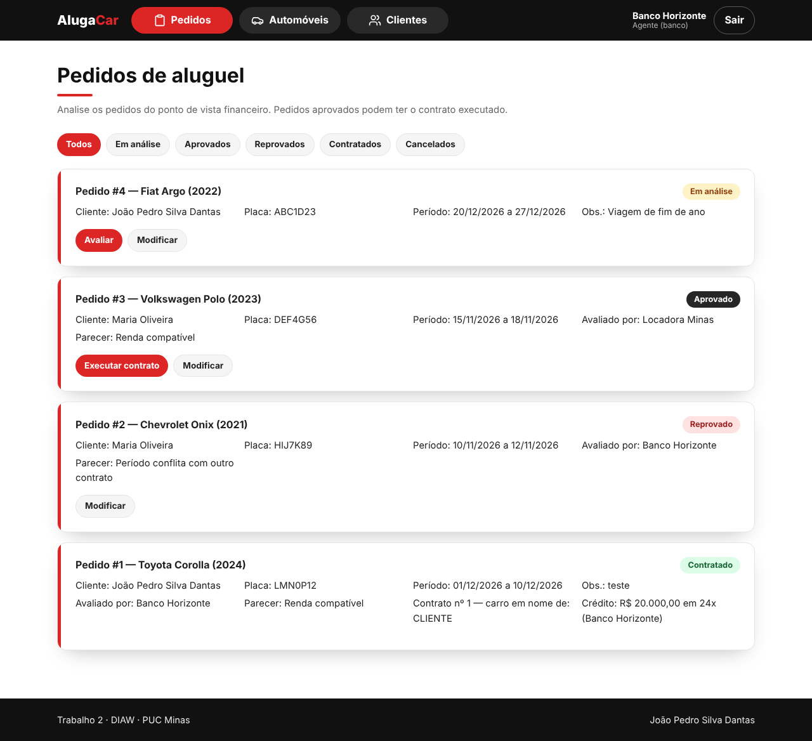
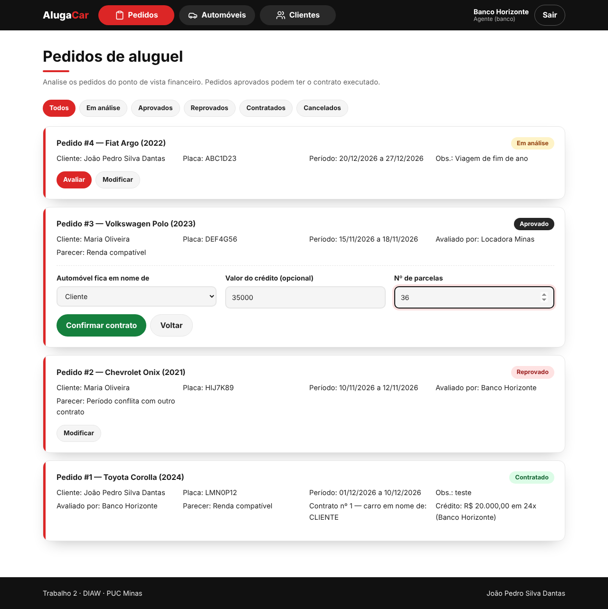
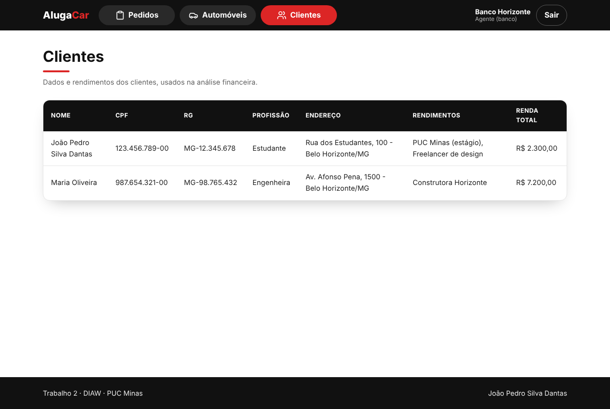

# 🚗 AlugaCar — Sistema de Aluguel de Carros

> [!NOTE]
> Sistema web para gestão de aluguéis de automóveis: **clientes** fazem, modificam, consultam e cancelam pedidos pela internet, e **agentes** (empresas e bancos) avaliam esses pedidos do ponto de vista financeiro e executam os contratos.

Laboratório 02 da disciplina **Desenvolvimento e Integração de Aplicações Web (DIAW)** — Engenharia de Software, PUC Minas.

## 🚧 Status do Projeto


---

## 📚 Índice
- [Sobre o Projeto](#-sobre-o-projeto)
- [Funcionalidades Principais](#-funcionalidades-principais)
- [Tecnologias Utilizadas](#-tecnologias-utilizadas)
- [Arquitetura](#-arquitetura)
- [Modelagem (UML)](#-modelagem-uml)
- [Instalação e Execução](#-instalação-e-execução)
- [Rotas da API](#-rotas-da-api)
- [Estrutura de Pastas](#-estrutura-de-pastas)
- [Demonstração](#-demonstração)
- [Testes](#-testes)
- [Documentações utilizadas](#-documentações-utilizadas)
- [Autor](#-autor)
- [Agradecimentos](#-agradecimentos)
- [Licença](#-licença)

---

## 📝 Sobre o Projeto

O objetivo é apoiar a gestão de aluguéis de automóveis, permitindo efetuar, cancelar e modificar pedidos pela internet.

- O sistema só pode ser usado após **cadastro prévio e autenticação** (login com usuário e senha).
- **Clientes** (usuários individuais) introduzem, modificam, consultam e cancelam pedidos de aluguel.
- **Agentes** (empresas e bancos) modificam e avaliam pedidos. Pedidos com **parecer positivo** ficam disponíveis para a **execução do contrato**.
- Do cliente são guardados RG, CPF, nome, endereço, profissão e até **3 rendimentos** (entidade empregadora + valor).
- Do automóvel são guardados matrícula, ano, marca, modelo e placa. Dependendo do contrato, o carro fica registrado como propriedade do **cliente**, da **empresa** ou do **banco**.
- O aluguel pode estar associado a um **contrato de crédito** concedido por um banco agente.

O sistema é dividido em dois subsistemas: **gestão de pedidos e contratos** (back-end Spring Boot) e **construção dinâmica das páginas web** (front-end React).

---

## ✨ Funcionalidades Principais

- 🔐 **Autenticação:** login obrigatório com usuário e senha (senhas criptografadas com BCrypt). Cliente e agente têm menus e permissões diferentes.
- 👤 **CRUD de cliente:** cadastro, consulta, edição e exclusão da conta, com até 3 rendimentos.
- 📝 **Pedidos (cliente):** criar pedido escolhendo carro e período, acompanhar o status, modificar e cancelar (enquanto estiver em análise).
- 🏦 **Avaliação (agente):** ver todos os pedidos com filtro por status, dar parecer financeiro (aprovar/reprovar) e modificar pedidos.
- 📄 **Contratos:** executar o contrato de pedidos aprovados, definindo o proprietário do carro. Bancos podem associar um **contrato de crédito** (valor e parcelas).
- 🚘 **Automóveis:** os carros disponíveis são criados automaticamente ao iniciar o sistema e aparecem para o cliente escolher no pedido.

> [!NOTE]
> **Sobre a tela de automóveis:** chegamos a desenvolver uma tela para os agentes cadastrarem, editarem e excluírem automóveis, mas por causa do prazo de entrega do trabalho decidimos retirá-la da versão final do front-end, para manter o escopo enxuto e focado no que o enunciado pede. As rotas desse cadastro continuam no back-end (`/api/agente/automoveis`) e podem ser usadas por uma tela futura.
- 👥 **Clientes:** agentes consultam os clientes e a renda total de cada um.

Fluxo de status do pedido:

```
EM_ANALISE ──(agente aprova)──> APROVADO ──(agente executa contrato)──> CONTRATADO
     │
     ├──(agente reprova)──> REPROVADO
     └──(cliente cancela)──> CANCELADO
```

---

## 🛠️ Tecnologias Utilizadas

### 💻 Front-end
- **Biblioteca:** React 19
- **Rotas:** React Router
- **Build Tool:** Vite
- **Estilização:** CSS puro, paleta preto e vermelho, com componentes do meu portfólio (Lab01): menu em pílulas, título com barrinha, cartões com faixa e link animado
- **Ícones:** SVG no estilo [Lucide](https://lucide.dev/) (componente `Icone.jsx`)
- **Comunicação com a API:** `fetch` (arquivo `src/services/api.js`)

### 🖥️ Back-end
- **Linguagem:** Java (JDK 25)
- **Framework:** Spring Boot 4.0.x (Spring MVC, Spring Data JPA, Spring Security, Bean Validation)
- **Build e dependências:** Apache Maven
- **Banco de dados:** Supabase (PostgreSQL)
- **ORM:** Hibernate (JPA)
- **Autenticação:** Spring Security com HTTP Basic + BCrypt

---

## 🏗️ Arquitetura

O projeto segue a arquitetura **MVC** em camadas:

| Camada | Onde fica | Responsabilidade |
|---|---|---|
| **View** | `frontend/src` (React) | Telas que o usuário vê; chamam a API |
| **Controller** | `backend/.../controller` | Recebe as requisições HTTP e devolve JSON |
| **Service** | `backend/.../service` | Regras de negócio (quem pode fazer o quê) |
| **Repository** | `backend/.../repository` | Acesso ao banco com Spring Data JPA |
| **Model** | `backend/.../model` | Entidades que viram tabelas no PostgreSQL |

Pacotes de apoio: `dto` (dados de entrada/saída da API, sem expor a senha), `exception` (erros tratados e devolvidos como `{ "mensagem": "..." }`) e `config` (segurança e dados iniciais).

**Autenticação:** a tela de login envia `login:senha` em Base64 para `GET /api/auth/me`. Se estiver certo, o front guarda essas credenciais e as manda no cabeçalho `Authorization: Basic ...` em todas as próximas requisições. O Spring Security confere a senha e libera as rotas de acordo com o perfil (`/api/cliente/**` só para CLIENTE e `/api/agente/**` só para AGENTE).

**Integração front ↔ back:** o Vite redireciona tudo que começa com `/api` para `http://localhost:8080` (proxy em `vite.config.js`), então não há problema de CORS no desenvolvimento.

---

## 📐 Modelagem (UML)

Todas as versões dos diagramas estão em [`docs/diagramas`](docs/diagramas), junto com a explicação do que mudou entre elas. As [histórias de usuário](docs/historias-de-usuario.md) estão em `docs/`.

| Casos de uso (v2) | Classes (v2) | Pacotes (v2) |
|:---:|:---:|:---:|
|  |  |  |

---

## 🔧 Instalação e Execução

### Pré-requisitos
- **JDK 25** (ex.: Eclipse Temurin 25)
- **Apache Maven 3.9+**
- **Node.js** 20.19+ ou 22.12+ (com npm)
- Uma conta gratuita no **Supabase** com um projeto criado

### 🔑 Variáveis de Ambiente (back-end)

Copie `backend/.env.example` para `backend/.env` e preencha com os dados do Supabase (**Connect → Session pooler**):

| Variável | Exemplo |
|---|---|
| `SUPABASE_DB_URL` | `jdbc:postgresql://aws-0-sa-east-1.pooler.supabase.com:5432/postgres?sslmode=require` |
| `SUPABASE_DB_USER` | `postgres.abcdefghijklmnop` |
| `SUPABASE_DB_PASSWORD` | senha do banco definida ao criar o projeto |

> [!IMPORTANT]
> O arquivo `.env` está no `.gitignore` e **não** deve ir para o GitHub.

### 🗄️ Banco de dados
Não é preciso criar tabelas manualmente: o Hibernate cria tudo na primeira execução (`spring.jpa.hibernate.ddl-auto=update`). Também são criados automaticamente 2 agentes e 4 automóveis para teste:

| Login | Senha | Perfil |
|---|---|---|
| `locadora` | `123456` | Agente — Empresa |
| `banco` | `123456` | Agente — Banco |

Clientes são criados pela tela **Cadastre-se**.

### ⚡ Como executar

**Terminal 1 — back-end**
```bash
cd backend
mvn spring-boot:run
```
API em `http://localhost:8080`.

**Terminal 2 — front-end**
```bash
cd frontend
npm install
npm run dev
```
Aplicação em `http://localhost:5173`.

---

## 🔌 Rotas da API

| Método | Rota | Quem acessa | Descrição |
|---|---|---|---|
| POST | `/api/auth/cadastro` | público | Cadastro de cliente |
| GET | `/api/auth/me` | logado | Dados do usuário logado (usado no login) |
| GET / PUT / DELETE | `/api/cliente/perfil` | cliente | Consultar, alterar e excluir a própria conta |
| GET / POST | `/api/cliente/pedidos` | cliente | Listar e criar pedidos |
| PUT | `/api/cliente/pedidos/{id}` | cliente | Modificar pedido |
| PATCH | `/api/cliente/pedidos/{id}/cancelar` | cliente | Cancelar pedido |
| GET | `/api/automoveis` | logado | Listar automóveis |
| POST / PUT / DELETE | `/api/agente/automoveis[/{id}]` | agente | Manter automóveis (sem tela no front-end, ver observação acima) |
| GET | `/api/agente/clientes` | agente | Listar clientes |
| GET | `/api/agente/pedidos` | agente | Listar todos os pedidos |
| PUT | `/api/agente/pedidos/{id}` | agente | Modificar pedido |
| PATCH | `/api/agente/pedidos/{id}/avaliacao` | agente | Aprovar/reprovar com parecer |
| POST | `/api/agente/pedidos/{id}/contrato` | agente | Executar contrato (e crédito, se banco) |

---

## 📂 Estrutura de Pastas

```
.
├── README.md
├── .gitignore
├── docs/
│   ├── historias-de-usuario.md
│   ├── images/                    # prints da aplicação
│   └── diagramas/
│       ├── README.md              # o que mudou entre as versões
│       ├── v1/                    # modelagem inicial (.png)
│       └── v2/                    # modelagem revisada (.png)
├── backend/                       # Spring Boot (Maven)
│   ├── pom.xml
│   ├── .env.example
│   └── src/main/
│       ├── resources/application.properties
│       └── java/br/pucminas/aluguelcarros/
│           ├── AluguelCarrosApplication.java
│           ├── config/            # SecurityConfig, DadosIniciais
│           ├── controller/        # rotas da API
│           ├── dto/               # objetos de entrada e saída
│           ├── exception/         # erros e TratadorDeErros
│           ├── model/             # entidades JPA
│           ├── repository/        # Spring Data JPA
│           └── service/           # regras de negócio
└── frontend/                      # React + Vite
    ├── package.json
    ├── vite.config.js             # proxy /api -> localhost:8080
    └── src/
        ├── App.jsx                # rotas das páginas
        ├── main.jsx
        ├── index.css
        ├── components/            # Navbar, Rodape, CabecalhoPagina, DetalhesPedido, FormCliente, FormPedido, StatusBadge, Mensagem, Icone, RotaProtegida
        ├── pages/                 # Login, Cadastro, Perfil, MeusPedidos, PedidosAgente, Clientes
        ├── services/api.js        # chamadas ao back-end
        └── utils/formatar.js      # moeda (R$) e datas
```

---

## 🎥 Demonstração

| Login | Cadastro de cliente |
|:---:|:---:|
|  |  |

| Pedidos do cliente | Meu perfil (CRUD) |
|:---:|:---:|
|  |  |

| Pedidos do agente | Banco executando contrato com crédito |
|:---:|:---:|
|  |  |

| Clientes (agente) |
|:---:|
|  |

---:|:---:|
|  |  |

| Pedidos do cliente | Meu perfil (CRUD) |
|:---:|:---:|
|  |  |

| Banco executando contrato com crédito | Pedido contratado |
|:---:|:---:|
|  |  |

---

## 🧪 Testes

Roteiro de teste manual (fluxo completo):

1. Abrir `http://localhost:5173` → deve ir para o login (rotas protegidas).
2. **Cadastre-se** como cliente com 1 a 3 rendimentos → fazer login.
3. Em **Meus pedidos**, criar um pedido → status **Em análise**.
4. Modificar e depois criar outro pedido e cancelá-lo → status **Cancelado**.
5. Sair e entrar como `banco` / `123456` → **Avaliar** o pedido com um parecer → **Aprovado**.
6. **Executar contrato** informando proprietário, valor do crédito e parcelas → **Contratado**.
7. Entrar de novo como cliente → ver o status **Contratado** com os dados do contrato e do crédito.
8. Entrar como `locadora` → ao executar contrato não aparecem os campos de crédito (só bancos concedem crédito; a API também bloqueia).

---

## 🔗 Documentações utilizadas
- [Spring Boot](https://docs.spring.io/spring-boot/index.html)
- [Spring Security](https://docs.spring.io/spring-security/reference/index.html)
- [Spring Data JPA](https://docs.spring.io/spring-data/jpa/reference/index.html)
- [Supabase](https://supabase.com/docs)
- [React](https://react.dev/)
- [React Router](https://reactrouter.com/)
- [Vite](https://vite.dev/)
- [PlantUML](https://plantuml.com/)

---

---

## 🤖 Uso de Inteligência Artificial

A inteligência artificial foi utilizada como ferramenta de apoio durante o desenvolvimento do projeto, principalmente para:

- **Geração de ícones:** auxílio na criação de alguns ícones utilizados na interface.
- **Documentação:** auxílio na elaboração e organização deste README.
- **Correção de bugs:** apoio na identificação e correção de alguns bugs e comportamentos inesperados durante o desenvolvimento.

A IA foi utilizada como recurso complementar, com revisão e validação das alterações realizadas pela equipe.

---

## 👥 Autor

| Nome | GitHub | LinkedIn | E-mail |
|---|---|---|---|
| João Pedro Silva Dantas | [joaodantas-eng](https://github.com/joaodantas-eng) | [joaopedrosdantas](https://www.linkedin.com/in/joaopedrosdantas/) | joaopedrosilvadantas3@gmail.com |

---

## 🙏 Agradecimentos
- **[Engenharia de Software PUC Minas](https://www.instagram.com/engsoftwarepucminas/)** — pelo suporte institucional.
- **Prof. João Paulo Carneiro Aramuni** — pela orientação na disciplina e pelo template de README.

---

## 📄 Licença

Este projeto é distribuído sob a **[Licença MIT](https://github.com/joaopauloaramuni/laboratorio-de-desenvolvimento-de-software/blob/main/LICENSE)**.
